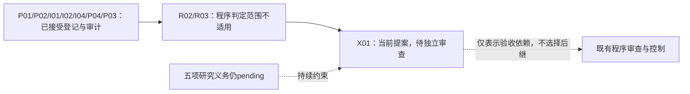

# X01 实际位置与依赖视图

2026-10-17，spectrum-round2-work-harness；cycle=1，index=9，step_id=X01，attempt=1，worker=harness.planner.000011。本视图依据 round-000011/planner-input 和 X01/planner-history 的固定快照，不是实时全主机监控。证据路径、真实 SHA-256、17份回执和9份接受记录见 research-state/X01-evidence-readback-attempt-000001.json。

## 实际位置

程序记录9个已处理节点，其中7个经独立审查接受：P01目标登记、P02资产清点、I01入口、I02父问题、I04退出标准、P04资源边界、P03队列优先级。R02、R03的 disposition=not_applicable，原因是 immutable contract 未包含 revision；没有虚构这两项研究执行或审查。最近实质接受的是P03，最近程序记录是R03。

文字替代：已接受的目标、资产、入口、父问题、退出、资源、队列记录支撑当前X01；X01需要独立reviewer检查后才能由程序推进。84节点/221关系的规范地图不等于运行历史，图中只显示已观察的当前位置与验收依赖，不登记新路线或新调度器。

17个既往worker/reviewer调用均已终态：2次模型不支持失败，15次进程完成；其中round 3虽进程完成，仍因ContractError被拒绝。未重试这些调用。当前输入inspection_refs=[]、repair_basis=[]，无新native回执或never-started cancellation；execution_task_ids=[]。Controller摘要为空不能推出当前worker不存在，也不能证明全主机没有其他工作。已结算1376.6760483998805秒包含失败与审查；不是训练时间，当前调用未结算，订阅token/费用及历史科研总投入未知。

## 依赖状态与可行工作

状态含义：evidenced=有指定范围的证据；missing=所需证据尚未取得；blocked=有已知访问/授权/前置障碍；unknown=没有足够观察。不是科学评级，任何一项evidenced都不能补偿另一项missing。

| 义务/依赖 | 状态 | 当前证据、限制和解除条件 |
|---|---|---|
| restore-evidence：快照与资产盘点 | evidenced，整体pending | P02及其acceptance支持输入身份和资产范围；不支持原始指标复算。 |
| 原始程序、CSV、评分与审计源对象 | blocked/missing | 父级恢复记录在所查位置16对象未取得、远端not our ref；只约束这些位置，不证明其他位置不存在。需真实原始字节和版本才解除。 |
| source-and-community：讨论卡片 | evidenced，整体pending | 已读取全部5张JSON：3条保留讨论、1条排除、1条原论文摘要跟进。帖子、可见评论、推断分开；图片未读，部分评论未穷尽，不构成普遍性或因果证据。 |
| 相关论文全文、作者代码及native评价协议 | missing | 目前社区跟进仅摘要/元数据；全文和代码核验仍欠账。本节点复用来源观察，不声称新增外部D2阅读。 |
| second-round-inquiry：机制与强简单替代 | missing，整体pending | accepted_decision_ref=null；自然失败链、共同分母、SSD n=64、方向/强度/锚点信息控制和生成→学习传递尚不足。父级建议仍未选定。 |
| 独立审查 | evidenced于P01至P03既往七节点；X01及最终报告missing | P03 reviewer真实运行与输出已读，其结论仅认可队列审计。X01交既有程序另行独立审查；不由本worker自签。 |
| deliver-research-decision | missing，整体pending | 尚需可复核中文第二轮报告、来源定位、竞争解释、预测/falsifier、最小后续检查及独立审查。此定位表不替代最终报告。 |
| 当前科学执行、训练、GPU、SSH、原生评分 | blocked by scope | 用户仅授权阅读研究；不能启动实验或科学测试。数据/权重/GPU实时可用性unknown，未检查。 |
| 单worker串行社区读取 | 授权evidenced，持续登录unknown | 最新provider-handoff取代旧parent-only文字；父级检索已结束。节点需要时可串行只读，当前X01复用卡片即可，不重设一次搜索限制。 |
| 程序续行 | 当前调用evidenced，未来存活unknown | 本次真实worker调用及历史独立review已观察；保存文件不保证后台永久运行，不创建竞争consumer。 |

可行的来源阅读和记录工作不因可选来源访问或实验未授权而全局阻断。缺少raw数据的分支需证据恢复；恢复失败可支持有边界的证据修复报告，不能支持科学PASS。来源核验分支可检查目标函数、条件化信息与格式偏好等竞争解释。构造/实验分支仍待科学门和授权；这些是条件依赖，不是本worker选择的后继。

## 目标与历史欠账保持可见

目标仍是依据SPECTRUM既有结果进行第二轮研究，核验原始论文/代码和讨论线索，比较机制与强简单替代，提出可证伪预测和最小决定性后续检查，交付中文证据报告及独立审查。允许证据修复或无需新方法；当前once/research合同不授权manuscript、revision、release、communication，不能发布或发消息。

P03队列保留的历史科学计划完整继承：core 45、scale 45、mechanism 25、token_matched 15、diagnostic 4，共134 training arm-rounds；另24 transfer及3 decoder jobs。它们是既有计划而非本轮执行。当前coverage的experiment_contracts=[]、任务绑定为空，不据此删除历史欠账，也不伪造已冻结可执行任务。SSD n=64不能用n=16填充；五轮不是五次独立训练，语义标签不能填零或标完成。

既有审计的负面解释保留为历史报告层级：正确率非劣标准未满足、SSD n=16强替代挑战、APPS不利点估计；AST丰富度不能等同语义策略保留，共同合格分母必须保留。新社区卡没有提供解除这些缺口的实验结果。新版provider所有权只改变读取可行性，不改变科学门或排序。

最新用户续行覆盖旧六次/1800秒/一次检索限制；300秒watchdog是单次故障检测。保持现有账号模型、累计账目、源pin和输入不变。根目录authorization.md首次读取失败，已找到并读取research-state/authorization.md；本地安装技能与采用的Harness不同，遵循本次明确固定源，不修改安装。所有新增文件仅在research-state/或reports/。

本次decision_ref=null，不虚构v4决策链。新coverage严格以当前已接受P03 coverage为previous_ref，五项义务均保持pending，全部旧证据、任务绑定、描述及experiment_contracts原样保留，只增加本次定位证据。tasks=[]表示X01材料可送独立审查，不是全目标完成、科学通过或任何实验/语义标注完成。提交后由已有程序读取固定材料、执行独立审查并决定游标；本worker不选择后继。
